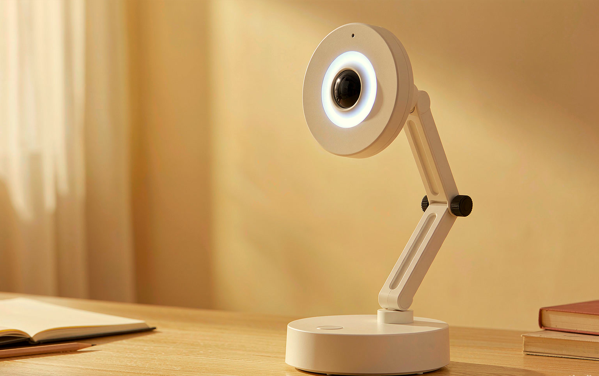

# LAMP—1 · AI 学习桌面机器人

> 一个放在桌面上的 AI 学习机器人：能听、能说、能看、会动。<br>
> ESP32-S3 做身体，云端大模型做大脑。

[官网](https://zhouxiaoshan499.github.io/Studylamp/) · [数字样机](https://zhouxiaoshan499.github.io/Studylamp/simulator.html?mode=voice) · [产品定位与开发规划](docs/11-AI学习机器人产品定位与开发规划.md) · [仓库文档](#文档导航)



*图为 REV C 形态的书桌场景概念渲染（白壳全包 · 宽导光环 · 单柱摩擦关节），非量产。*

> **2026-11-02 定位调整**：项目已**取消 LED 照明模组**，不再开发传统台灯的照明功能。产品从「AI 机器人台灯」转为「**AI 学习桌面机器人**」。灯环只做状态反馈，不做照明。
>
> `LAMP—1` 继续作为项目代号使用（仓库、域名不变），对外统一称 **AI 学习机器人**。

## 项目简介

LAMP—1 是一款面向大学生、年轻人及居家学习人群的桌面 AI 机器人交互设备。它以 ESP32-S3 为核心控制器，结合语音交互、AI 大模型、摄像头视觉感知、机械舵机和屏幕显示，实现能够听、说、看、动的桌面智能助手。

设备可以通过语音与用户交流，回答学习问题、提供学习提醒，并通过舵机实现转头、点头等动作，同时利用屏幕表情和灯环状态反馈增强交互体验。

它不再以照明为主要功能，而是以**学习辅助**和**桌面智能交互**为核心，让 AI 从手机、电脑里的软件助手，转变为具有实体形态的桌面机器人。

> 一句话策略：**先能力、后硬件；先闭环、后场景；先验证、后承诺。**

## 为什么调整

| 维度 | 调整前（台灯方案） | 调整后（AI 学习机器人） |
|------|-------------------|------------------------|
| 产品品类 | AI 机器人交互台灯 | 桌面 AI 学习机器人 |
| 第一功能 | 照明 + 语音 + 动作 | AI 语音交互 + 机械动作 |
| 照明模组 | LED 灯板 / 5V 灯环 + MOSFET 调光 | **取消**，灯环仅做状态反馈 |
| 屏幕 | 2.8″ 圆屏 / 0.96″ OLED | 1.09″ TFT（随 RIG-Arm） |
| 摄像头 | 列为「不开发」 | GC0308，阶段二做基础在场检测 |
| 机械 | 双轴云台（PWM 舵机） | 总线舵机 1–2 个，转头 / 点头 |

**结论**：不为了保留「台灯」这个名字而勉强加入照明。当前硬件更适合把机器人交互做好，尤其是第一阶段的语音问答、舵机动作和屏幕表情。

## 用户与场景

学习过程中，用户经常需要在书本、电脑、手机和其他设备之间切换。查知识、设计时、设提醒，往往要拿起手机、解锁、打开应用、点好几次，容易打断学习节奏。

用户希望拥有一个放在桌面上的智能设备，可以通过语音直接完成简单的学习辅助操作，不必频繁切换设备。

| 用户群体 | 主要需求 | 优先级 |
|----------|----------|--------|
| 大学生 | 学习问答、知识解释、学习计时、任务提醒 | P0 |
| 居家学习人群 | 语音操作、学习提醒、桌面辅助 | P0 |
| 年轻人 | 桌面 AI 交互、日常信息查询、智能陪伴 | P1 |
| 居家办公人群 | 快速语音问答、简单任务提醒 | P2 |

## 核心功能

| # | 功能 | 说明 | 优先级 | 阶段 | 状态 |
|---|------|------|--------|------|------|
| 1 | AI 语音问答 | 拾音 → 云端 ASR → LLM → TTS 播报 | P0 | 一 | 🟡 本地链路已通，云端/TTS 未接 |
| 2 | 机械舵机动作 | 总线舵机转头、点头、待机微动 | P0 | 一 | ⬜ 未接总线舵机 |
| 3 | 屏幕表情与状态 | 1.09″ TFT 显示聆听 / 思考 / 回答 / 计时 | P1 | 一 | ⬜ 未接入 |
| 4 | 灯环状态反馈 | WS2812B 灯环表达状态，不做照明 | P1 | 二 | ⬜ 灯环未到 |
| 5 | 摄像头视觉感知 | GC0308 采集图像，基础人员在场检测 | P2 | 二 | ⬜ 未接入 |
| 6 | 学习计时与提醒 | 番茄钟、倒计时、任务提醒、时长记录 | P1 | 三 | 🟡 倒计时已有 |

> 摄像头「检测到有人」不等于「用户在学习」。前期只承诺基础人员在场检测，不宣传自动识别学习状态。

## 硬件配置

### 当前阶段（保持不变）

> 现在正在用的硬件。本次调整不改动它，也不要求现在购买 RIG-Arm。

| 部件 | 型号 / 规格 | 用途 | 状态 |
|------|-------------|------|------|
| 主控 | ESP32-S3-DEVKITC-1（N16R8，16MB Flash / 8MB PSRAM） | 控制、联网、音频采集 | ✅ 在用 |
| 麦克风 | INMP441（I2S MEMS，32-bit 槽宽） | 语音采集 | ✅ 已跑通 |
| 按键 | HW-483 轻触按键 | 按键说话 / 交互触发 | ✅ 已跑通 |
| 调试负载 | HW-479 模块（仅 G 通道） | 仅作台架 PWM / 状态输出调试，不进入产品 BOM | ✅ 在用 |
| 状态灯 | 板载 / 外接 LED（GPIO14） | 运行状态提示 | ✅ 已跑通 |
| 电脑 | PC + Vosk + Ollama | 开发期 ASR / LLM 服务 | ✅ 在用 |
| 屏幕 / 舵机 / 摄像头 / 灯环 / 功放 | — | 后续阶段接入 | ⬜ 未接 |

### 后续阶段（RIG-Arm 套件，尚未到手）

| 硬件名称 | 数量 | 主要用途 | 阶段 | 到位 |
|----------|------|----------|------|------|
| RIG ESP32-S3 主控板 | 1 | 核心控制、网络通信 | 一 | ⬜ |
| 板载麦克风 | 1 | 语音采集 | 一 | ⬜ |
| MAX98357 功放 | 1 | 音频放大 | 一 | ⬜ |
| 配套扬声器 | 1 | AI 语音播报 | 一 | ❓ 需确认是否已有 |
| 1.09″ TFT 屏幕 | 1 | 表情与状态显示 | 一 | ⬜ |
| 总线舵机 | 1–2（套件共 5 路） | 转头、点头 | 一 | ⬜ |
| GC0308 摄像头 | 1 | 图像采集、基础在场检测 | 二 | ⬜ |
| WS2812B 48mm 灯环 | 1 | 交互状态反馈（非照明） | 二 | ⬜ |
| 舵机独立电源 | 1 | 舵机供电，与主控共地 | 一 | ⬜ |

### 已取消

| 硬件 | 原用途 | 取消原因 |
|------|--------|----------|
| LED 照明灯板 | 台灯主照明 | 产品不再做照明 |
| MOSFET 灯光驱动电路 | 灯板开关 / 调光 | 随照明取消 |
| PWM 亮度 / 色温调节模块 | 调光调色 | 随照明取消 |
| 2.8″ 480×480 圆形屏幕 | 原台灯方案的大屏 | 改用 RIG-Arm 自带 1.09″ TFT |
| M5Stack StickS3 | 早期备选主控 | 统一到 RIG ESP32-S3 主控板 |

## 系统架构

```text
        用户语音 / 桌面画面
                │
                ▼
┌───────────────────────────────┐
│ ESP32-S3 设备端                │
│ 音频采集 · 图像采集 · Wi-Fi     │
│ 状态机 · 舵机 · TFT · 灯环      │
└───────────────┬───────────────┘
                │ HTTPS / WebSocket
                ▼
┌───────────────────────────────┐
│ 云端 AI 服务                   │
│ ASR 语音识别 · LLM 大模型 · TTS │
└───────────────┬───────────────┘
                │
                ▼
        扬声器 · 舵机 · TFT 表情 · 灯环状态
```

| 技术模块 | 目标实现 | 现状 |
|----------|----------|------|
| 主控开发 | ESP-IDF / C++ | PlatformIO + Arduino 主固件；另有 ESP-IDF 实验工程 |
| 语音采集 | I2S | INMP441 已跑通 |
| 语音识别 | 云端 ASR | 开发期用本地 Vosk |
| AI 问答 | 云端 LLM API | 开发期用本地 Ollama |
| 语音播报 | 云端 TTS + MAX98357 | 未接 |
| 舵机控制 | UART 总线舵机 | 现有 PWM 舵机代码，总线协议待重写 |
| 屏幕显示 | 1.09″ TFT | 未接 |
| 摄像头 | GC0308 + 基础检测 | 未接 |
| 灯环控制 | WS2812B + RMT | 未接 |
| 学习计时 | ESP Timer / FreeRTOS | 倒计时已有 |
| 数据保存 | NVS | 已有配置存储 |

> ESP32-S3 只负责设备控制、音视频采集与网络通信，**不直接运行大型语言模型**；复杂视觉识别不在当前阶段承诺范围内。

## 开发规划

### 阶段总览

| 阶段 | 名称 | 目标 | 硬件 | 验收标准 | 状态 |
|------|------|------|------|----------|------|
| **0** | 台架验证（当前） | 在现有开发板上跑稳语音闭环与协议 | 现有开发板 + INMP441 + 按键 + PC | 提问 → 文本回答可连续复现 | 🔄 进行中 |
| **一** | 核心 MVP | 先做出能交流、能动作的机器人 | RIG-Arm（到位后） | 提问 → AI 回答 → 语音播报 → 舵机动作 | ⬜ 待硬件 |
| **二** | 视觉感知与灯环联动 | 具备基础视觉感知与状态联动 | + GC0308 + WS2812B 灯环 | 画面可采集、在场检测可运行、状态能联动 | ⬜ 待硬件 |
| **三** | 学习辅助与整机完善 | 从交互机器人升级为学习设备 | 整机结构 | 整机联动 + 学习功能可用 | ⬜ 待开始 |

### 阶段一：核心 MVP

目标：先做出能交流、能动作的机器人。

| # | 任务 | 依赖 | 验收 |
|---|------|------|------|
| 1 | ESP32-S3 连接 Wi-Fi | 无 | 上电自动联网，断线重连 |
| 2 | 麦克风采集语音 | RIG-Arm 板载麦 | 16 kHz 单声道稳定采集 |
| 3 | 对接云端 ASR、LLM、TTS | 云服务账号 | 一句话完成识别 → 回答 → 合成 |
| 4 | 扬声器播放 AI 回答 | MAX98357 + 扬声器 | 回答可听清，无明显爆音 |
| 5 | 1–2 个总线舵机实现点头、转头 | RIG-Arm 舵机 + 独立电源 | 动作平滑、限位安全 |
| 6 | TFT 显示聆听 / 思考 / 回答 | 1.09″ TFT | 状态与语音流程同步 |

**验收**：用户提问 → AI 回答 → 语音播报 → 舵机动作。

### 阶段二：视觉感知与灯环联动

目标：让设备具备基础视觉感知能力。

| # | 任务 | 依赖 | 验收 |
|---|------|------|------|
| 1 | 接入 GC0308 摄像头 | 摄像头 + 接口 | 稳定出图 |
| 2 | 实现稳定图像采集 | 阶段二硬件 | 连续 10 分钟不崩溃 |
| 3 | 尝试基础人员在场检测 | 采集链路 | 有人 / 无人可运行 |
| 4 | 接入 WS2812B 灯环 | 48mm 灯环 | 状态色可编程 |
| 5 | 联动屏幕、灯环与舵机状态 | 上述模块 | 同一状态三处反馈一致 |

**验收**：摄像头能够采集画面，基础在场检测可运行，交互状态能够联动反馈。

### 阶段三：学习辅助与整机完善

目标：从 AI 交互机器人升级为学习辅助设备。

| # | 任务 | 依赖 | 验收 |
|---|------|------|------|
| 1 | 学习问答与知识解释 | 阶段一语音链路 | 学习类问题回答可用 |
| 2 | 番茄钟、学习计时 | TFT / 灯环 | 25/45 分钟计时准确 |
| 3 | 学习任务与休息提醒 | TTS + 舵机 + 灯环 | 到点多通道提醒 |
| 4 | 基础学习时间记录 | NVS | 可按天查询专注时长 |
| 5 | 优化外壳、舵机结构与交互 | 结构件 | 整机可稳定摆放与演示 |

**验收**：完成 AI 交互、机械反馈、视觉感知和学习辅助功能的整机联动。

> 完整任务拆解、依赖关系、里程碑与风险见 [docs/11](docs/11-AI学习机器人产品定位与开发规划.md)。

## 仓库结构

```text
lamp/
├── README.md                     本文件
├── docs/                         方案、验证与项目记录
│   ├── 11-AI学习机器人产品定位与开发规划.md   ← 当前主文档
│   ├── 09-智能交互台灯项目总结.md       台灯时期总结（历史口径）
│   ├── 10-照明方案调整.md             照明方案记录（已被取消）
│   ├── 07-语音产品化方案.md           云端 ASR/LLM/TTS、成本与延迟
│   ├── 08-对标AutonomousLamp模型接入方案.md
│   ├── 06-语音AI链路实施手册.md        麦克风、服务端、串口联调
│   ├── 06-面包板点亮验证.md           按键 → 灯的最小闭环
│   ├── 03-技术方案.md                早期硬件与照明方案（历史）
│   ├── 01-商业计划书.md              早期商业与财务测算（历史）
│   ├── 02-市场调研与竞品分析.md        市场与竞品（历史）
│   ├── 04-MVP验证计划.md             用户验证与指标阈值
│   └── 05-风险与里程碑.md            风险登记册与阶段门
├── firmware/                     ESP32-S3 固件（本分支未改动）
│   ├── src/
│   │   ├── main.cpp
│   │   ├── voice_client.cpp
│   │   ├── pdm_mic.cpp           INMP441 I2S 采集
│   │   ├── lighting.cpp          台架照明通道（仅调试）
│   │   ├── motion.cpp            PWM 舵机（总线舵机待重写）
│   │   ├── timer_task.cpp
│   │   ├── ui.cpp
│   │   └── ir_engine.cpp / ir_store.cpp   红外后备代码
│   ├── src/bringup/              按键 → 灯的最小验证
│   ├── idf/lamp_voice/           ESP-IDF 语音客户端
│   ├── idf/pdm_probe/            ESP-IDF 麦克风探针
│   ├── micropython/              开发板 bring-up 脚本
│   └── include/                  配置、引脚与 secrets 模板
├── server/                       语音服务（开发链路，未改动）
│   ├── voice_server.py           WS 8765：PCM → Vosk → Ollama
│   ├── lamp_server.py            TCP 8766 + HTTP 8080
│   ├── ask.py / asr_test.py / test_client.py
│   └── models/                   Vosk 模型，不入库
├── web/                          官网与数字样机（仅改文案）
│   ├── index.html
│   ├── product.html
│   ├── simulator.html            第一阶段台架样机（保留照明调试控件）
│   ├── technology.html
│   └── assets/
├── tools/
│   └── mvp_calc.py               BOM / 功耗 / 热 / 经济性计算器
└── .github/workflows/pages.yml   GitHub Pages 自动部署
```

## 快速开始

### 1. 官网与数字样机

线上地址：

- 官网：<https://zhouxiaoshan499.github.io/Studylamp/>
- 数字样机：<https://zhouxiaoshan499.github.io/Studylamp/simulator.html?mode=voice>

本地直接打开，无需构建：

```powershell
start web\index.html
```

> 数字样机是**前端脚本模拟**：不录音、不上传、不调用真实大模型。它仍保留第一阶段台架的光控调试控件，照明不再是产品功能。

### 2. 编译固件

需要 PlatformIO + ESP32-S3 平台。

```powershell
cd firmware

# 面包板最小验证：按键 → 灯
pio run -e bringup -t upload
pio device monitor -b 115200

# 完整固件：语音 + 灯环 + 舵机 + 定时
pio run -e lamp_s3 -t upload
```

注意：

- 当前主控为 ESP32-S3 N16R8（16 MB Flash / 8 MB PSRAM）；
- INMP441 必须使用 32-bit 槽宽；
- ESP32-S3 只有 LEDC 通道 0–7，主固件已改用 0–4；
- 面包板只接按键/灯时先跑 `bringup`，不要直接烧完整固件。

ESP-IDF 版本在 `firmware/idf/lamp_voice`，可用 `idf.py build` 单独构建；它不是当前主路径。

### 3. 启动语音服务（开发链路）

需要 Python 3.10+、Ollama，以及本地 Vosk 模型。

```powershell
cd server
python -m venv .venv
.\.venv\Scripts\Activate.ps1
pip install -r requirements.txt

# 下载 Vosk 中文小模型到 server/models/
New-Item -ItemType Directory -Force models | Out-Null
Invoke-WebRequest https://alphacephei.com/vosk/models/vosk-model-small-cn-0.22.zip -OutFile models\vosk-model-small-cn-0.22.zip
Expand-Archive models\vosk-model-small-cn-0.22.zip models

# 大脑：默认 qwen3:14b，机器吃紧可换更小模型
ollama pull qwen3:14b

# 先自检 ASR + LLM
python voice_server.py --check

# 启动服务
python voice_server.py
```

另开一个终端，不用开发板也能验证整条链路：

```powershell
python test_client.py
python test_client.py --text "今天适合复习吗"
```

服务默认监听 `0.0.0.0:8765`。`lamp_server.py` 是 ESP-IDF 版的 TCP/HTTP 服务，端口 8766/8080，和 `voice_server.py` 不冲突。

### 4. 让 ESP32 连上来

1. 复制配置模板：

   ```powershell
   copy firmware\include\secrets.h.example firmware\include\secrets.h
   ```

2. 填入 Wi-Fi 名称、密码和运行 `voice_server.py` 的电脑 IP；
3. 保证 ESP32 和电脑在同一网段，放行 8765 端口；
4. 烧录后串口执行：

   ```text
   mic test 10
   voice status
   voice say 今天适合复习吗
   ```

更完整的接线、串口输出和排障见 `docs/06-语音AI链路实施手册.md`。

## 文档导航

| 文档 | 作用 |
|------|------|
| [11-AI学习机器人产品定位与开发规划.md](docs/11-AI学习机器人产品定位与开发规划.md) | **当前主文档**：定位、用户、功能、硬件、技术、三阶段规划 |
| [12-插电即用语音开关灯方案.md](docs/12-插电即用语音开关灯方案.md) | 阶段 0 Demo Rig v0.5：离线命令词 + 低压 MOS 驱动的选型与实施决策 |
| [MVP 初始阶段说明](docs/mvp/README.md) | 阶段 0 台架验证实物照片（speech.jpg）说明，语音交互最小闭环 |
| [09-智能交互台灯项目总结.md](docs/09-智能交互台灯项目总结.md) | 台灯时期总结，保留历史口径与硬件演进记录 |
| [10-照明方案调整.md](docs/10-照明方案调整.md) | 照明方案调整为单色灯环的记录，现已整体取消 |
| [07-语音产品化方案.md](docs/07-语音产品化方案.md) | 云端 ASR/LLM/TTS、按键触发、成本与延迟 |
| [08-对标AutonomousLamp模型接入方案.md](docs/08-对标AutonomousLamp模型接入方案.md) | 模型接入与 tool calling 迁移 |
| [06-语音AI链路实施手册.md](docs/06-语音AI链路实施手册.md) | 麦克风、服务端、串口联调步骤 |
| [06-面包板点亮验证.md](docs/06-面包板点亮验证.md) | 按键 → 灯的最小闭环 |
| [03-技术方案.md](docs/03-技术方案.md) | 早期硬件、引脚、照明、机械、定时（历史口径） |
| [01-商业计划书.md](docs/01-商业计划书.md) | 早期商业与财务测算（历史口径） |
| [02-市场调研与竞品分析.md](docs/02-市场调研与竞品分析.md) | 市场与竞品（历史口径） |
| [04-MVP验证计划.md](docs/04-MVP验证计划.md) | 早期用户验证计划（红外 / 照明口径，历史） |
| [05-风险与里程碑.md](docs/05-风险与里程碑.md) | 早期风险登记册与阶段门（历史） |

> `docs/01–05` 保留早期「红外优先 / 台灯照明」口径，部分结论已被 `docs/09–11` 取代。当前口径以 `docs/11` 和本 README 为准。

## 边界与风险

- 项目处于 **概念 / MVP 阶段**，不构成量产承诺；
- 照明模组已取消，但固件与数字样机中仍保留照明相关代码与控件，仅作台架调试，不代表产品功能；
- RIG-Arm 套件、灯环、摄像头尚未到位，舵机、屏幕、视觉、播报均未做整机验证；
- 当前语音链路依赖电脑 + Ollama，**尚未做到「不插电脑」**；云端 ASR/LLM/TTS 是阶段一目标；
- 摄像头只承诺基础人员在场检测，不承诺学习状态、坐姿或专注度识别；
- 学习场景需求、用户付费意愿、桌面机器人形态均未经过真实用户验证；
- 未做 3C/CE、EMC、热、跌落和寿命测试；
- 部分历史文档/代码注释仍保留台灯、双色温、红外优先等表述，以 `docs/11` 和实际接线为准。

## 现阶段最重要的三件事

1. 用现有台架把云端语音链路跑通，做到「不依赖电脑」；
2. RIG-Arm 到位后，先点亮麦、屏、喇叭，再上舵机动作；
3. 用真实用户验证「语音 + 动作 + 屏幕/灯环」是否比手机助手更适合学习桌面。

---

项目核心不是再做一盏更聪明的台灯，而是把 AI 从屏幕里拿出来，放到桌面上。
