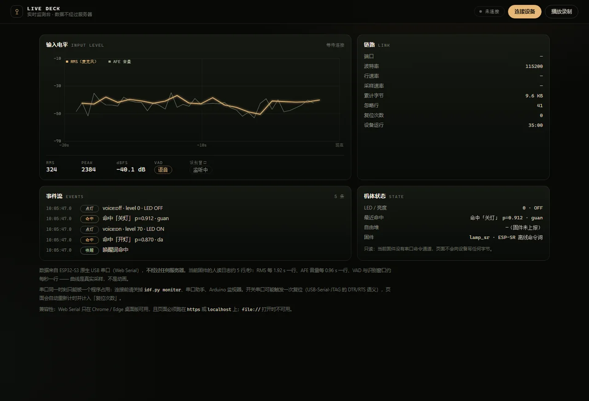

# 28 实时数据方案 v2：浏览器直连 USB（2026-11-11）

> **文档性质**：在 `docs/25`（服务端中继）之上重做的主力方案。硬件已插上、实测过端口与固件之后写。
>
> **一句话**：数据不走服务器，Chrome 用 **Web Serial** 直接读 ESP32-S3 原生 USB（COM6），解析后 20 ms 内上屏。零后端、零 CORS、零混合内容，GitHub Pages 也能用。
>
> **与 `docs/25` 的关系**：25 的服务端中继**不废弃**，降级为「手机 / 远程 / 不支持 Web Serial」的第二通道；两条通道共用同一套解析与渲染（`live-parser.js` / `live.js` 的 `ingest()`）。定位仍以 `11` 为准，排期以 `24` 为准。

---

## 0. 实测记录（2026-11-11 09:56–10:10）

| 事实 | 测得值 | 对方案的影响 |
|------|--------|--------------|
| 可用串口 | **COM6**，`USB VID:PID=303A:1001`，`USB 串行设备` | 是 ESP32-S3 **原生 USB-Serial-JTAG**，不是 CH343/CP2102 桥。Web Serial 可直连 |
| 另一路 CH343 | COM5，`1A86:55D3`，状态 `CM_PROB_PHANTOM` | 幽灵设备，物理上没插；总线舵机/机械臂**不在线** |
| 固件 | `lamp_sr`，启动横幅 `LAMP-SR ready (window=600000ms, auto-reopen)` | 当前只有「离线命令词 + 点灯」，没有 WiFi、舵机、屏幕、摄像头 |
| 日志速率 | **4.9 行/秒，约 260 B/s** | 115200 带宽的 2%，远没跑满 |
| 麦克风电平 | `mic peak=… rms=…` 每 **1.92 s** 一行 | 这就是当前能拿到的最高「实时」分辨率 |
| AFE 音量 | `diag: afe_out=… vol=-42.3` 每 **0.96 s** 一行 | 比 RMS 快一倍，可当第二路参考 |
| VAD | `vad=speech dbfs=-38…-53` 约 1 行/秒 | 安静房间里**一直判 speech**，见 §6.1 |
| 开关串口 | uptime 从 `6951 ms` 掉回 `1984 ms` | **开/关端口会复位板子**（DTR/RTS 语义）。页面必须容忍复位 |
| 解析结果 | 183 行 → 62 采样 / 80 状态 / 41 诊断噪声 | 噪声行是 AFE 峰值比，属预期 |
| 本地静态服务 | `live.html` 与 4 个资源全部 200 | 页面可独立打开，不依赖构建 |

> 一句话总结实测：**这块板现在就在往 USB 吐真实数据，只是没人接。** 浏览器可以直接接住。

---

## 1. 为什么 v2 比 v1 好

| 维度 | v1：服务端中继（`docs/25`） | **v2：Web Serial 直连（本文）** |
|------|------------------------------|-------------------------------|
| 需要常开进程 | 需要 `lamp_server.py` / `python -m http.server` | **不需要**，页面自己读串口 |
| 数据路径 | 串口 → Python → HTTP/SSE → 浏览器 | **串口 → 浏览器**，一跳 |
| 延迟 | 串口桥 20–60 ms + SSE 缓冲 | **~2 ms**（USB CDC 轮询 + 行解析） |
| CORS / 混合内容 | Pages(https) 连本机(http) 被拦，必须反代 | **没有这个问题**，无网络请求 |
| 部署 | PC 防火墙、端口、跨域白名单 | 一个静态 HTML |
| 手机 / 平板 | 能（走局域网） | **不能**（Web Serial 仅桌面 Chromium） |
| 多端同时看 | 能，多浏览器订阅同一 SSE | 不能，串口同一时刻只归一个页面 |
| 断线恢复 | 自己写重连 | 浏览器事件 + 重试，页面已处理 |
| 权限模型 | 网络暴露，要 token | **系统级端口选择器**，用户点一次才授权 |
| 新增能力 | 无 | 能拿到只有 USB 才有的东西：复位事件、逐行原始日志、将来的固件命令通道 |
| 开发量 | 1–1.5 人日 | 已完成（见 §3） |

**结论**：自己桌上 / 展会 / 录视频 → v2；远端同事想看 / 手机看 → v1；两个都要就都留，共用解析层。

---

## 2. 架构

```text
                 ┌──────────────────────── 浏览器 ────────────────────────┐
ESP32-S3         │                                                        │
  ├─ 原生 USB ───┼─► navigator.serial ─► TextDecoderStream ─┐              │
  │  (COM6)      │                                          ├─► ingest() ──┼─► 状态 / 曲线 / 事件流
  └─ 串口日志     │                                          │   (同一入口) │
                 │   SSE（v1 服务端中继，预留）──────────────┘              │
                 │   录制回放 assets/live-demo.json ─────────┘              │
                 └────────────────────────────────────────────────────────┘

解析层：web/assets/live-parser.js   ← 纯函数，Node 可测，无 DOM
渲染层：web/assets/live.js          ← 数据源 + 画布 + DOM
页面：  web/live.html
```

设计要点只有一条：**「一行文本」是唯一的数据入口**。串口来的一行、SSE 来的一行、录制文件里的一行，都进 `ingest(line)`。换数据源不用改渲染。

---

## 3. 已交付（今天就能点开看）

| 文件 | 行数 | 作用 |
|------|------|------|
| [`web/live.html`](../web/live.html) | 272 | 监测台页面：电平曲线、读数、链路、机体状态、事件流 |
| [`web/assets/live-parser.js`](../web/assets/live-parser.js) | 208 | 解析层。当前固件的 ESP_LOG 与将来的 `#T/#S/#E/#H` 都认 |
| [`web/assets/live.js`](../web/assets/live.js) | 485 | Web Serial 读取、回放、画布、状态机、错误提示 |
| [`web/assets/live-demo.json`](../web/assets/live-demo.json) | 183 行 | 40 s 真实串口录制，无设备时的 DEMO 素材（带录制时间） |
| [`tools/test-live-deck.js`](../tools/test-live-deck.js) | 126 | 19 项断言，`node tools/test-live-deck.js` 跑 |

**怎么打开**（必须 `localhost` 或 `https`，`file://` 下 Web Serial 不存在）：

```powershell
# 仓库根目录
server\venv\Scripts\python.exe -m http.server 8099 --directory web
# Chrome / Edge 打开
#   http://127.0.0.1:8099/live.html
```

1. 先关掉 `idf.py monitor`、串口助手（串口独占）。
2. 点「连接设备」→ 选 **COM6（USB 串行设备 / ESP32-S3）**。
3. 板子可能复位一次，约 1.5 s 后开始出数。
4. 对着 INMP441 说「开灯」，事件流里会出现「命中『开灯』p=0.87 · da kai deng」，LED 卡片变成 `70 · ON`。



上图是不接设备、把 40 s 真实录制按 18 s 展开注入后的渲染结果（无头 Chrome + CDP 截图），可以看到：曲线用的是真实电平采样点、读数跟着最新样本走、事件流按时间倒序。空状态与 390×844 移动端布局也各自截过一遍。

已验证：

- `node --check` 两个文件通过；`node tools/test-live-deck.js` **19 项断言全过**。
- `live.html` 与全部资源经本地 HTTP 返回 200。
- 无头 Chrome 渲染验证：21 个 RMS 点 + 41 个 AFE 点 + 5 条事件，桌面 1440×980 与移动 390×844 两档布局都正常。
- **未验证**：点「连接设备」触发系统端口选择器这一步需要真人点，无法自动完成 —— 留给你。

---

## 4. 页面上的每个数字从哪来

| 显示项 | 来源 | 当前频率 | 现在有吗 |
|--------|------|----------|----------|
| RMS / PEAK | `I (…) lamp_sr: mic peak=… rms=…` | 1.92 s | 有 |
| dBFS | 由 rms 换算 `20·log10(rms/32768)`；或 `diag … vol=` | 1.92 s / 0.96 s | 有 |
| VAD（语音 / 静音） | `W (…) lamp_sr: vad=speech dbfs=…` | ~1 s | 有，但见 §6.1 |
| 识别窗口 | `diag: mnState=` → 0 监听中 / 1 命中 / 2 过期 | 0.96 s | 有 |
| 命中事件 | `MN id=… prob=… text=…` | 事件 | 有 |
| 点灯事件 | `>>> voice:on level=70 LED=ON` | 事件 | 有 |
| 唤醒 | `*** wake word detected` | 事件 | 有 |
| 复位 | uptime 回退检测 | 事件 | 有 |
| 自由堆 | 固件没打 | — | **没有**，显示「固件未上报」 |
| 姿态 / 在场 / 表情 / 计时 | 对应硬件都没接 | — | **没有**，不显示、不编 |

**曲线不是波形**：它是 20 s 窗口里真实的电平采样点连线，两条线分别 1.92 s 和 0.96 s 一个点。没有插值、没有随机数、没有动画 —— 点稀疏本身就是当前固件的实话。

---

## 5. 刷 20 行固件 → 10 Hz 结构化流（P0.5）

现在解析的是 ESP_LOG 人读文本，能用但脆：改一句日志就断。加一个专用信道，5 处改动：

### 5.1 协议

```text
#H,{"fw":"0.5.0","proto":1,"caps":["led","mic","telemetry"]}\n   启动时一次
#T,<ms>,<rms>,<peak>,<dbfs>,<vad>,<mn>,<heap>,<brightness>\n     每 100 ms
#S,<ms>,brightness=<n>,heap=<n>\n                                亮度变化时
#E,<ms>,<kind>,<text>\n                                          wake / command / error
```

- `#` 开头永不和 ESP_LOG 撞；一行一个样本，不连行、不转义。
- CSV 约 40 B/行，10 Hz = 400 B/s，占 115200 的 3.5%（JSON 要 120 B/行）。
- `dbfs` 用**整数 dBFS**（`-43`）传，不用浮点：ESP-IDF 若开了 `CONFIG_NEWLIB_NANO_FORMAT`，`%f` 会打印成空，整数最省事。

### 5.2 插入点（按当前 `firmware/idf/lamp_sr/main/main.c` 行号）

| # | 位置 | 加什么 |
|---|------|--------|
| 1 | `main.c:108` `setLevel()` 末尾 | `telemetry_state()` → `#S`（亮度变化才发） |
| 2 | `main.c:341` 启动横幅后 | `telemetry_hello()` → `#H` |
| 3 | `main.c:501` 之后（`while(1)` 循环末尾，`mnState` 已算出） | 每 100 ms 发 `#T`；`sPeak/sSqSum/sSqCnt` 的累计逻辑留在 `main.c:382–393` 不动 |
| 4 | `main.c:462–469` 唤醒分支 | `telemetry_event("wake", "wake word")` |
| 5 | `main.c:481–489` 命中分支 | `telemetry_event("command", …)`，带 id/prob |
| 6 | `main.c:409–448` DIAG 块 | 整块包进 `#if LAMP_DIAG`，平时不打（省 2 行/秒噪声） |

### 5.3 参考实现

```c
#define LAMP_TELEMETRY 1
#if LAMP_TELEMETRY
#include "esp_system.h"

static inline int32_t tel_now_ms(void) { return (int32_t)(esp_timer_get_time() / 1000); }

static void telemetry_hello(void)
{
    printf("#H,{\"fw\":\"0.5.0\",\"proto\":1,\"caps\":[\"led\",\"mic\",\"telemetry\"]}\n");
}

static void telemetry_state(int brightness)
{
    printf("#S,%ld,brightness=%d,heap=%u\n",
           (long)tel_now_ms(), brightness, (unsigned)(esp_get_free_heap_size() / 1024));
}

static void telemetry_event(const char *kind, const char *text)
{
    printf("#E,%ld,%s,%s\n", (long)tel_now_ms(), kind, text);
}

static void telemetry_sample(int rms, int peak, int dbfs, int vad, int mn, int brightness)
{
    printf("#T,%ld,%d,%d,%d,%d,%d,%u,%d\n",
           (long)tel_now_ms(), rms, peak, dbfs, vad, mn,
           (unsigned)(esp_get_free_heap_size() / 1024), brightness);
}
#endif
```

主循环末尾（`mnState` 处理完、`main.c:501` 之后）发样本 —— 必须放在这里，因为 `res` 和 `mnState` 要到这时才有效：

```c
static int64_t sWinStart = 0;
if (esp_timer_get_time() - sWinStart >= 100000) {          // 100 ms
    int rms = sSqCnt ? (int)(sqrtf((float)sSqSum / sSqCnt)) : 0;
    int dbfs = rms > 0 ? (int)lrintf(20.0f * log10f((float)rms / 32768.0f)) : -90;
    telemetry_sample(rms, (int)sPeak, dbfs, res->vad_state == VAD_SPEECH,
                     (int)mnState, sBrightness);
    sPeak = 0; sSqSum = 0; sSqCnt = 0; sWinStart = esp_timer_get_time();
}
```

`sPeak / sSqSum / sSqCnt` 的累计仍在原来的采样循环（`main.c:382–393`）里做，只把「每 60 帧打印一次」的 `main.c:394–401` 删掉或挪进 `#if LAMP_DIAG`。

**收益**：采样率 0.52 Hz → 10 Hz（19 倍）；堆、VAD、识别状态同帧；曲线终于像示波器；日志噪声可关。
**代价**：约 20 行；`idf.py build flash monitor` 一次；`printf` 走 stdout → UART0 + USB-Serial-JTAG，两路都能看到。

> 我没有替你刷机：现在板子上跑的是能用的固件，刷写应在你确认后做。改完这 20 行，页面不用改 —— 解析层已经认 `#T`（测试里有覆盖）。

---

## 6. 比「显示数据」更值得先做的两件事

### 6.1 VAD 一直在误报 speech

实测：安静房间里 `vad=speech dbfs=-38…-53`，每秒一条，从不静音。这不是展示问题，是识别链路的问题：

- 可能性一：`MIC_PRE_GAIN 8`（+18 dB）把底噪一起放大，AFE 的 VAD 阈值相对变低。
- 可能性二：INMP441 的 L/R 未接地导致底噪偏高（已知硬件坑）。
- 可能性三：AFE 的 `afe_linear_gain` 与预增益叠加过头。

**为什么先修它**：页面上的 VAD 门现在永远是「语音」，观众会以为是页面坏了；更关键的是 VAD 误报会让 MultiNet 一直在噪声上跑，白白消耗算力、抬高误唤醒。修好之后仪表才对得上。

### 6.2 用事件流反过来验证「直说能开灯」的稳定性

实测 40 s 里 `mnState` 一直是 0（监听中），没有任何命中。说明当前环境（距离/增益/噪声）下识别还没稳定触发。事件流正好是量化这件事的工具：连续说 10 次「开灯」，数命中几次、prob 分布如何 —— 比「感觉能认」靠谱。建议把它写进 `docs/20` 的实测口径。

---

## 7. 分阶段路线

| 阶段 | 内容 | 依赖 | 工作量 |
|------|------|------|--------|
| **P0（已完成）** | Web Serial 监测台 + 解析层 + 回放 + 测试 | 无 | 已完成 |
| P0.5 | 固件 20 行 `#T/#S/#E/#H` + 关掉 DIAG 噪声 | 你确认后刷机 | 0.5 人日 |
| P1 | 修 VAD 误报；用事件流做识别率实测 | 硬件在手 | 0.5–1 人日 |
| P2 | 舵机接上：姿态进同一协议（`pose` 字段），页面加姿态盘；或 Web Serial 开第二个端口直读 CH343 总线 | 舵机到货 | 1–2 人日 |
| P3 | `simulator.html?live=1`：把同一份 state 灌进 `window.__lampSim`，样机跟着真机转 | P2 | 2 人日 |
| P4 | 远端/手机：把 v1 的 SSE 源接进 `ingest()`；`docs/25` 的 CORS + 反代方案 | 需要常开 PC | 1 人日 |
| P5 | 页面上线：`live.html` 进导航、首页加「连接真机」入口 | P0 | 0.5 人日 |

---

## 8. 验收

| 指标 | 目标 | 现状 |
|------|------|------|
| 首条数据上屏 | ≤ 2 s（含可能的复位重启） | 复位后启动约 1.5 s + 首行立即 |
| 事件延迟 | ≤ 100 ms | USB CDC 直读，实测即时 |
| 复位自动识别 | 清空曲线 + 计次 + 事件 | 已实现，测试覆盖 |
| 无设备可用 | 回放 40 s 真实录制 | 已实现，标录制时间 |
| 不支持时说明 | 明确提示 + 禁用按钮 | 已实现（Firefox/Safari/iOS） |
| 页面渲染 | 桌面与移动两档都无溢出、无遮挡 | 无头 Chrome 截图核对 |
| 只读安全 | 不向串口写任何字节 | 已实现（无 writable 调用） |
| 逻辑正确性 | 19 项断言 | 全过 |

---

## 9. 已知限制（要写在脸上）

1. **只有 Chrome / Edge 桌面版**。Safari、Firefox、iOS、Android 全部不支持 Web Serial。
2. **页面必须 `https` 或 `localhost`**，`file://` 打开时 `navigator.serial` 不存在。
3. **串口独占**：`idf.py monitor` 开着就连不上，报 `NetworkError`，页面会提示先关掉。
4. **开/关端口可能复位板子**（实测），页面把它记成「复位次数」，不假装没发生。
5. **现在解析的是人读日志**，固件改日志格式就可能断 —— 所以推 §5 的 `#` 行。
6. **不传音频、不传 PCM、不写入设备**：页面只读，隐私面为零。
7. **GitHub Pages 上默认没数据**：访客没有你的板子，页面会提示连接失败或用回放。别在 Pages 上把 DEMO 写成实测。

---

## 10. 与 `docs/25` 的合并

- `docs/25` 的架构图、SSE 契约、CORS/反代、公网三形态**继续有效**，作为 v2 的第二通道。
- 两套共用 `live-parser.js`；v1 的服务端只需把收到的串口行通过 SSE 原样下发，前端 `ingest(line)` 即可，不用改渲染。
- 数据口径、三态徽标（DEVICE / SERVER / DEMO / STALE）在 v2 里落成：`live`（绿）= 真机 USB，`replay`（蓝）= 录制，`error`（红）= 断开。
