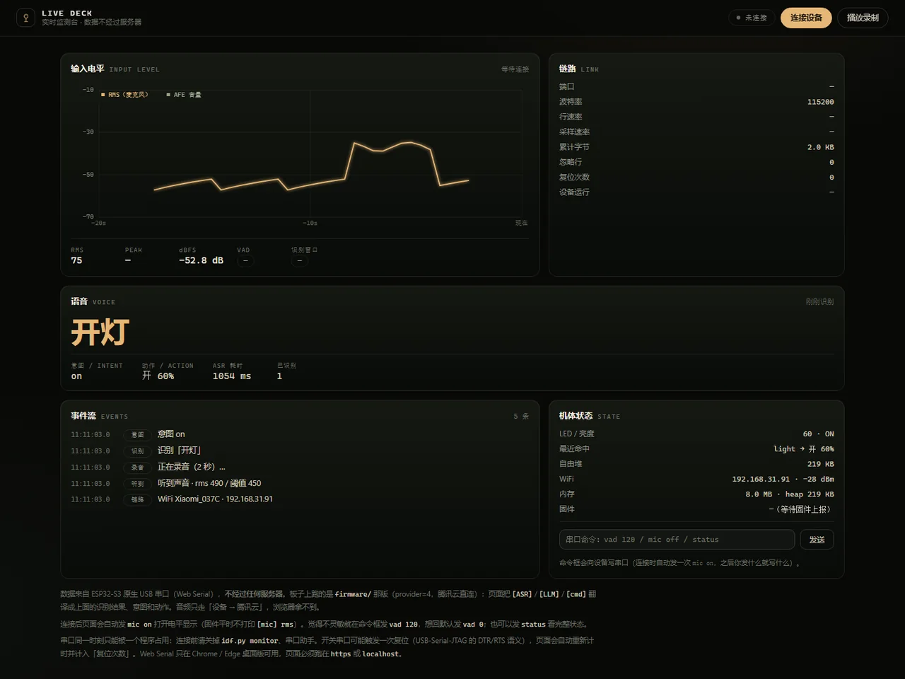
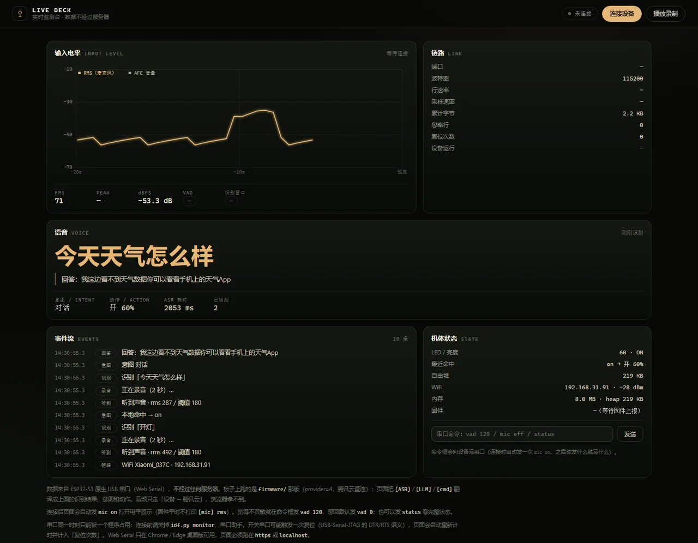

# 29 腾讯云联调实录（2026-11-11）

> **文档性质**：过程记录，冻结不改，只引用。对应方案 `docs/14`（TC3/SNTP 工程细节）、`docs/26`（三接口与成本）。
> 本文只记**实测到的事实**：哪一步通了、卡在哪、错误码怎么读、下一步点什么。不写预期值。
>
> **口径**：Key 一律打码；本文不含任何可用凭据。

---

## 0. 一页纸结论

| 环节 | 状态 | 证据 |
|------|------|------|
| TC3 签名实现 | ✅ **通过** | 官方示例向量逐字节一致；与官方 SDK `sign_tc3()` 交叉验证相同 |
| 端点与请求格式 | ✅ **通过** | 假 SecretId 得到 `AuthFailure.SecretIdNotFound`（而不是网络/格式错误） |
| 腾讯云鉴权（SecretId/SecretKey） | ✅ **通过** | `UnauthorizedOperation` → 换新 Key + 授权后直接出结果 |
| **语音识别 ASR** | ✅ **通过** | `kaitest.wav` → `开灯。`；常见 200–400 ms，偶发 1.5–2 s |
| **语音合成 TTS** | ✅ **通过** | `TextToVoice` → RIFF/WAV 16 kHz 单声道，9 字 656 ms |
| **大模型 LLM** | ✅ **通过** | TokenHub `deepseek/deepseek-flash`，5 条命令全对，中位 1.6 s |
| **设备端直连** | ✅ **通过** | ESP32-S3 连 WiFi + SNTP，说「开灯」「关灯」→ LED 真亮真灭，端到端约 5 s |
| **网页显示** | ✅ **通过** | `web/live.html` 经 Web Serial 显示识别文本/意图/动作（§2.4） |
| 网站 Key | 未放入 | `web/` Key 扫描 0 命中 |

> 一句话：**「听、想、说」三跳在 PC 上全部跑通；「开灯/关灯」已经在开发板上端到端实现**（不需要喇叭）。下一步只剩「跳过 LLM 提速」和「硬件补齐」。

---

## 1. 环境

| 项 | 值 |
|----|-----|
| 主机 | Windows，`server/venv` Python 3.10 |
| 脚本 | `tools/tencent_voice_check.py`（纯标准库，不依赖腾讯 SDK） |
| 音频 | `server/kaitest.wav`，16 kHz / 单声道 / 16 bit / 1.32 s / 42446 B |
| 凭据来源 | `firmware/include/secrets.h`（已被 .gitignore；git 历史 0 命中） |
| 凭据形态 | SecretId `AKID…` 36 位 · SecretKey 32 位 · 模型 Key `sk-…` 51 位 |
| 密钥扫描 | `tools/scan_cloud_keys.py`：仅本地未跟踪 2 处，`web/` 0 处 |

---

## 2. 测试矩阵

| # | 用例 | 端点 | HTTP | 返回 Code | 读法 |
|---|------|------|------|-----------|------|
| 1 | `--self-test` 官方向量 | 本地 | — | — | payload SHA、UTC 日期、CanonicalRequest SHA、HMAC 链全对 |
| 2 | `--preflight` 假 SecretId | `asr.tencentcloudapi.com` | 200 | `AuthFailure.SecretIdNotFound` | 端点/JSON/签名头都被接受，只差真 Key |
| 3 | **真 Key 调 ASR** | `asr.tencentcloudapi.com` | 200 | **`AuthFailure.UnauthorizedOperation`** | 鉴权通过，是 CAM 策略问题 |
| 4 | 模型 Key → 混元 | `api.hunyuan.cloud.tencent.com` | 401 | `invalid_api_key` | 该 Key 不是这儿签的 |
| 5 | 模型 Key → TokenHub | `tokenhub.tencentcloudmaas.com` | 401 | `401002` | 同上，且两套入口 Key 不通用 |
| 6 | 模型 Key → LKEAP | `api.lkeap.cloud.tencent.com` | 401 | `not_authorized` | 也不是这套 |

第 3 条的原始返回（打码后）：

```json
{"Response":{"Error":{
  "Code":"AuthFailure.UnauthorizedOperation",
  "Message":"You are not authorized to perform this operation. Check your CAM policies... you are not authorized to perform operation (asr:SentenceRecognition) resource (*) has no permission"
},"RequestId":"3453cb38-…"}}
```

**为什么这条是好消息**：腾讯云的校验顺序是「SecretId 存在 → 验签 → CAM 授权」。能走到第三步，说明前两步都过了。如果签名错，这里会是 `AuthFailure.SignatureFailure`。

---

## 2.1 授权生效后的复查（2026-11-11 18:40）

换了一对新 Key（`AKIDZz…` / 32 位），CAM 授权 + 服务开通之后：

| 用例 | 音频 / 文本 | 结果 | 耗时 |
|------|-------------|------|------|
| ASR | `kaitest.wav` 1.32 s | `开灯。` | 203 ms（单次） |
| ASR | `guantest.wav` 1.35 s | `关灯。` | 203 ms（单次） |
| ASR | `test_zh.wav` 3.92 s | `你好，请用一句话介绍你自己。` | 203 ms（单次） |
| ASR ×5 精确计时 | `kaitest.wav` | 5/5 都是 `开灯。` | 中位 **187 ms**（157–234） |
| TTS | `我在。` | WAV 16000 Hz / 单声道 / 16 bit / 0.94 s | 515 ms |
| TTS | `我在，灯已经开了。`（9 字） | WAV 2.07 s / 66284 B | 656 ms |
| LLM | `开灯` | ⛔ `invalid_api_key` | — |

三点读数：

1. **ASR 稳定在 200 ms 量级**，比百炼那次的 10~13 s 好两个数量级；这个数字是「上传 + 识别 + 下载」的总耗时，还没有算录音与麦克风延迟。
2. **三句音频耗时都是 203 ms** 是巧合（脚本用 `%.0f` 取整），精确复测的抖动是 157–234 ms；跨会话再测又出现 297 / 360 / 1407 / 2187 ms——**网络和冷启动的影响比识别本身大**。写进方案时按「常见 200–400 ms，超时给 2 s」定预算，别拿最好成绩当常态。
3. **TTS 时长随字数线性增长**：9 字 2.07 s，合成耗时 656 ms，都符合预期；输出就是 16 kHz WAV，MAX98357 可以直接吃（不需要解码器）。

至此 `docs/26` 的三跳里，①听 ②想 ③说 **三跳全通**。

---

## 2.2 模型接通（2026-11-11 22:33）

之前三次 401 都不是 Key 的问题，是**入口和模型名**不对。三个坑：

| 坑 | 现象 | 正解 |
|----|------|------|
| 入口域名 | `tokenhub.tencentcloudmaas.com` → `401002` | 控制台给的是 **`tokenhub.tencentmaas.com`**（少一个 `cloud`） |
| 模型名 | `deepseek-v4.1-flash` → `invalid_api_key` / 400 | 带厂商前缀：**`deepseek/deepseek-flash`** |
| 推理模型 | HTTP 200，但 `content` 为空、`finish_reason=length` | `max_tokens=16` 全被 `reasoning_content` 吃光；加 `"thinking":{"type":"disabled"}` 关思考，`max_tokens ≥ 64` |

关掉思考后实测 5 条命令（`tokenhub.tencentmaas.com` + `deepseek/deepseek-flash`）：

| 输入 | 动作标签 | 耗时 | reasoning_tokens |
|------|----------|------|------------------|
| 开灯 | `on` | 1765 ms | 0 |
| 关灯 | `off` | 1375 ms | 0 |
| 亮一点 | `up` | 1203 ms | 0 |
| 暗一点 | `down` | 1641 ms | 0 |
| 最亮 | `max` | 1609 ms | 0 |

**5/5 正确，中位 1609 ms**（1203–1765）。开着思考时中位 2~3 s，还经常被 `max_tokens` 截断成空串。

端到端（同一台 PC，局域网）：

| 环节 | 耗时 |
|------|------|
| ASR（1.3 s 音频） | 187–437 ms |
| LLM（思考关） | 1.0–1.6 s |
| TTS（9 字） | ~0.66 s |
| **听 → 想 → 说 合计** | **约 1.8–2.7 s** |

**结论（对设备端的直接影响）**：台灯的 5 条命令是固定词表，**不需要走 LLM** —— 拿到 ASR 文本后本地关键词映射 <1 ms，端到端直接压到 ASR 那 ~0.2 s；LLM 留给「今天学什么」这类开放问答，且只在需要时调。这一条直接决定 `docs/26` 的设备端超时预算：固定命令 8 s 的 ASR 超时过于宽松，实际应压到 2 s。

---

## 2.3 设备端实测：板子直连腾讯云（2026-11-12 10:30–10:55）

固件线：`firmware/`（PlatformIO / Arduino），环境 `lamp_s3_tencent`（`-DLAMP_CLOUD_ASR_PROVIDER=4`）。
板子：ESP32-S3 N16R8（16 MB flash + 8 MB OPI PSRAM），原生 USB 口接 PC（COM6）。

### 2.3.1 启动日志（关键行）

```text
[voice] cloud ASR mode (tencent), 16 kHz mono s16le
[asr] key 来自 secrets.h（NVS 为空）
[asr] 第二跳 key 来自 secrets.h（腾讯 TokenHub）
[llm] 第二跳走腾讯 tokenhub.tencentmaas.com/v1/chat/completions model=DeepSeek-V4.1-Flash-1017
[asr] provider=tencent secretId=AKID... secretKey=set
[mic] selftest n=320 min=-3048 max=636
{"ev":"boot","fw":"0.1.0-mvp","heap":224544}
[mem] psram=8386247 heap=224344
{"ev":"wifi_begin","ssid":"Xiaomi_037C"}
[wifi] connected ssid="Xiaomi_037C" ip=192.168.31.91 rssi=-28
{"ev":"wifi_ok","ip":"192.168.31.91"}
[timer] epoch=1794451136 synced      ← SNTP 成功，TC3 的时间闸放行
```

### 2.3.2 两条真实语音的结果

| 动作 | 日志 | 耗时 |
|------|------|------|
| 说「开灯」 | `[ASR] "开灯"` → `[LLM] "开灯" -> on` → `[cmd] intent="on" -> on=1 pct=60` | 触发→识别 3.0 s，识别→动作 2.8 s |
| 说「关灯」 | `[ASR] "关灯"` → `[LLM] "关灯" -> off` → `[cmd] intent="off" -> on=0 pct=0` | 触发→识别 3.0 s，识别→动作 2.1 s |

`[asr] reply 133 B in ~1000 ms`：ASR 单次约 1 s，端到端从开口到灯变约 **5 s**，其中 2 s 是固定录音窗、1 s 是 ASR、2 s 是 LLM。

### 2.3.3 为跑通改的四处（都是设备端硬毛病，记下来免得重踩）

| # | 文件 | 改动 | 不改的后果 |
|---|------|------|-----------|
| 1 | `platformio.ini` | `-DARDUINO_USB_MODE=1 -DARDUINO_USB_CDC_ON_BOOT=1` | `Serial` 走 UART0，板子只接原生 USB，**一条日志都看不到** |
| 2 | `platformio.ini` | `board_build.arduino.memory_type = qio_opi` + `-DBOARD_HAS_PSRAM` | 85 KB 请求体只能退到碎片化内部堆，第 2~3 次调用就 `[asr] oom: body 87051 B` |
| 3 | `pdm_mic.cpp` | 删掉 `slot_mask = I2S_STD_SLOT_LEFT`（保持默认 BOTH） | 单声道只取左槽时 WS 周期缩成 32 BCLK，INMP441 输出带直流偏置，RMS 恒定 1450，ASR 永远「静音」 |
| 4 | `voice_client.cpp` | `handleIntent()` 先排除 `none` | `"none".indexOf("on") >= 0` 成立，模型回「无动作」反而把灯打开（实测复现） |

### 2.3.4 还没解决的

- **VAD 阈值偏低/偏高都难调**：噪声尖峰和远处说话都在 150~1500 之间，固定阈值必然二选一。已加「连续 2 帧 + 说完冷却 800 ms」，并开放串口命令 `vad <rms>` 现场调（`vad 0` 回默认）。
- **端到端 5 s 偏慢**：固定命令其实不需要 LLM（见 §2.2 结论），把 2 s 的 LLM 跳省掉可压到 ~3 s；再把固定 2 s 录音窗改成 VAD 收尾能再省 0.5~1 s。
- **没有喇叭**：`TextToVoice` 接口已验通（§2.1），但板上还没有 MAX98357，所以「说」这一跳只能存文件，听不见。

---

## 2.4 在网页上看识别结果（2026-11-12，无需喇叭）

板子只接原生 USB，识别结果本来只在串口日志里。把 `web/live.html` 连上去，就能把「听到 → 识别 → 意图 → 动作」实时显示在浏览器里：

```powershell
server\venv\Scripts\python.exe -m http.server 8099 --directory web
# Chrome / Edge 打开 http://127.0.0.1:8099/live.html → 「连接设备」→ 选 COM6
```

页面现在解析 `firmware/` 那版固件的人读日志：

| 页面元素 | 数据来源 |
|----------|----------|
| VOICE 大字 | `[ASR] "开灯"` |
| 意图 / 动作 | `[LLM] "开灯" -> on`、`[cmd] intent="on" -> on=1 pct=60` |
| ASR 耗时 | `[asr] reply 133 B in 1054 ms` |
| 电平曲线 | `[mic] rms=… floor=… thr=…`（固件平时不打，连接后页面自动发 `mic on`） |
| 事件流 | 听到 → 录音 → 识别 → 意图 → 动作 → WiFi/复位 |
| 状态卡 | `[wifi] connected`、`[mem] psram=… heap=…`、`{"ev":"light_set"}` |
| 命令框 | 直接发串口命令：`vad 120` / `vad 0` / `mic off` / `status` |

注意两点：

1. 浏览器占住串口时，别的程序（`idf.py monitor`、串口助手）读不了；反过来也一样。
2. 开关串口会让板子复位一次（DTR/RTS 语义），页面把它计入「复位次数」，WiFi 重连约 10 s。



---

## 2.5 混合路由：固定命令本地、其余对话走 LLM（2026-11-12 14:20）

### 2.5.1 怎么分流

`cloud_asr::interpret(text)` 是唯一入口（真机 ASR 和串口 `voice say` 都走它）：

```text
文本 → localintent::match()  ──命中──→ 直接返回 on/off/up/down/max/night/study/rest（<1 ms）
                            └─未命中─→ TokenHub classifyIntent()
                                          ├─ 只回标签（近义说法）
                                          └─ "ANSWER: …" 一句口语回答
```

- 本地词表在 `firmware/src/local_intent.cpp`，约 40 条说法：`开灯/打开灯/把灯开…`、`关灯/关掉灯/把灯关掉…`、`亮一点/太暗…`、`暗一点/太亮…`、`最亮/全亮`、`夜灯`、`学习模式`、`休息模式`。
- LLM 提示词改成两类：灯控只回标签；其它话用简体中文回答、以 `ANSWER:` 开头。返回后 `normalizeLlmReply()` 统一成「标签」或「ANSWER:…」两种形态，模型不守格式时宁可当对话也不误开灯。
- 串口新增两行：`[CMD] "开灯" -> on (local)` 与 `[REPLY] 我这边看不到天气数据…`。

### 2.5.2 实测（用 `voice say` 走同一条路由，排除麦克风变量）

| 输入 | 走的路 | 日志 | 模型调用 |
|------|--------|------|----------|
| 开灯 | 本地 | `[CMD] "开灯" -> on (local)` → `[cmd] intent="on" -> on=1 pct=60` | 0 次 |
| 关灯 | 本地 | `[CMD] "关灯" -> off (local)` | 0 次 |
| 把灯关掉 | 本地（同义词） | `[CMD] "把灯关掉" -> off (local)` | 0 次 |
| 亮一点 | 本地 | `[CMD] "亮一点" -> up (local)` | 0 次 |
| 最亮 | 本地 | `[CMD] "最亮" -> max (local)` | 0 次 |
| 你好，你是谁 | LLM | `[LLM] … -> 对话` → `[REPLY] 你想让我做什么呢…` | 1 次，约 2.0 s |
| 今天天气怎么样 | LLM | `[REPLY] 我这边看不到天气数据你可以看看手机上的天气App` | 1 次，约 2.1~3.0 s |

固定命令这条路端到端只剩「录音 2 s + ASR ~1 s」，比之前少了 LLM 的 1.5~2 s。

### 2.5.3 VAD 一并调了

| 参数 | 旧值 | 新值 | 原因 |
|------|------|------|------|
| `MIC_VAD_RMS` | 450 | **180** | 正常距离说话只有 200~400，450 完全没反应 |
| 自适应倍率 | 底噪 × 2.2 | **底噪 × 1.5** | ×2.2 在底噪 150 时把阈值推到 330，把人声吞掉 |
| 底噪封顶 | 无 | **220** | 环境噪声大时阈值飞走 |
| 触发确认 | 1 帧 | **连续 3 帧（96 ms）** | 单帧噪声尖峰不再触发 |
| 冷却 | 无 | **说完后 800 ms** | 句尾余音不会立刻二次触发 |

现场仍可用串口调：`vad 120`（更灵敏）/ `vad 0`（回默认）。

### 2.5.4 网页新增



「语音」卡片现在显示：识别文本（大字）、意图（本地命中会标出来）、动作、ASR 耗时、次数，以及闲聊时的「回答」；事件流里能区分「本地命中」和「意图/回答」。

---


## 3. 错误码即结论

| 错误码 | 真正含义 | 修法 |
|--------|----------|------|
| `AuthFailure.SecretIdNotFound` | SecretId 不存在（被删 / 填错 / 拿旧厂商的 Key） | 重新签发或改 `secrets.h` |
| `AuthFailure.SignatureFailure` | 签名串与实发请求不一致 | `--dry-run` 对照 API Explorer；检查 Content-Type |
| `AuthFailure.SignatureExpire` | 时间偏差 > 5 分钟 | 对时（设备端要 SNTP） |
| **`AuthFailure.UnauthorizedOperation`** | **签名没问题，子账号缺接口权限** | CAM 关联 `QcloudASRFullAccess`（TTS 再加 `QcloudTTSFullAccess`） |
| `FailedOperation.UserNotRegistered` | 主账号没开通「语音识别」 | 控制台开通服务 |
| `FailedOperation.ServiceIsolate` | 欠费停服 | 充值，1~2 分钟恢复 |
| `401002`（模型侧） | Key 与 Base URL 不是同一套入口 | 换 `--llm-host` 或换 Key |
| `invalid_api_key`（模型侧） | 混元控制台没有这把 Key | 去 `console.cloud.tencent.com/hunyuan/start` 重签 |

---

## 4. 下一步（控制台三件事）

### 4.1 给子账号授权（✅ 已完成 2026-11-11 18:40）


路径：**访问管理 CAM → 用户 → 该子账号 → 关联策略 → `QcloudASRFullAccess`**（语音识别全读写）。

只想最小授权的话，用自定义策略：

```json
{
  "version": "2.0",
  "statement": [
    {
      "effect": "allow",
      "action": ["asr:SentenceRecognition", "tts:TextToVoice"],
      "resource": ["*"]
    }
  ]
}
```

### 4.2 开通服务（✅ 已完成 2026-11-11 18:40）

「语音识别」→ 开通；要用 TTS 再开通「语音合成」。没开通会报 `FailedOperation.UserNotRegistered`。当前两项都已生效：ASR 与 TTS 均返回 200。

### 4.3 模型 Key 重新签一把（⛔ 唯一剩余阻塞项）

当前这把在混元 / TokenHub / LKEAP 三个入口全部被拒（三种不同错误码）。去混元控制台 `https://console.cloud.tencent.com/hunyuan/start` 创建 **API Key**，并确认模型已开通；把它填到 `LAMP_CLOUD_LLM_KEY`。

> 也可以暂时不签：台灯的五条命令（开灯/关灯/亮一点/暗一点/最亮）是**固定词表**，拿到 ASR 文本后用本地关键词表映射即可，不需要大模型。这条路 0 模型成本、0 首 token 延迟，正好先把「听到 → 灯变」闭环跑通；模型只用于开放问答。

---

## 5. 复测命令

```powershell
# 第一跳：耳朵（应直接出「开灯。」）
server\venv\Scripts\python.exe tools\tencent_voice_check.py --asr-only --wav server\kaitest.wav

# 第三跳：嘴（合成到 server/debug/）
server\venv\Scripts\python.exe tools\tencent_voice_check.py --tts --tts-text "我在，灯已经开了。"

# 两跳（还需要可用的模型 Key）
server\venv\Scripts\python.exe tools\tencent_voice_check.py --wav server\kaitest.wav

# 模型 Key 单验
server\venv\Scripts\python.exe tools\tencent_voice_check.py --llm-only --text 开灯

# 随时确认没有 Key 泄漏到公开产物
server\venv\Scripts\python.exe tools\scan_cloud_keys.py --web-only
```

---

## 6. 安全记录

1. 三把 Key 只在 `firmware/include/secrets.h`（gitignored，从未入库，git 历史检索 0 命中）。
2. `web/` 全目录 Key 扫描 0 命中——网站是公开产物，任何时候都不放 Key。
3. 排查模型 Key 归属时，把它发往了腾讯的三个官方入口（`api.hunyuan.cloud.tencent.com`、`tokenhub.tencentcloudmaas.com`、`api.lkeap.cloud.tencent.com`）。**若这把 `sk-` Key 实际属于其他平台，请立即去原平台轮换。**
4. 建议给子账号开用量告警 + 日限额，避免 VAD 误触发把额度烧掉。

---

## 7. 未做的事

- 没有把 Key 写进 `web/`，也没有做任何前端代理（用户明确要求不上网站）。
- 没有改固件：当前板上跑的是 `lamp_sr`（无 Wi-Fi），云端链路属于 `firmware/src` 那条线。
- 没有测 TTS：`TextToVoice` 要等授权与喇叭到货；只能验接口通不通，听不见。
