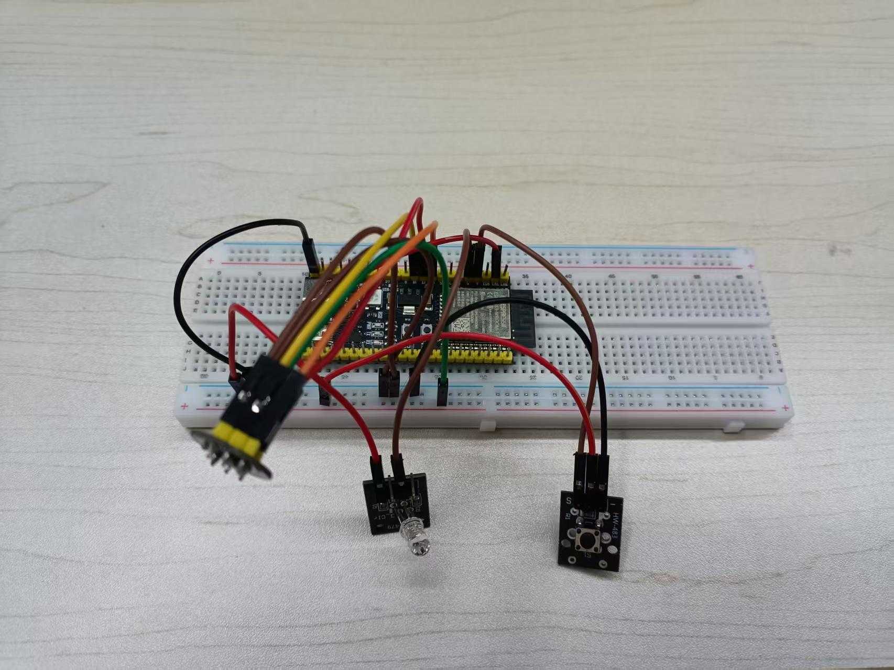

# MVP 初始阶段：语音交互台架验证（阶段 0）

> 这是 LAMP—1（AI 学习桌面机器人）在**阶段 0「台架验证」**下的实物原型照片说明。
> 它回答了一个问题：**在做出成品外壳和 RIG-Arm 套件之前，能不能先在一块面包板上，证明「人开口说话 → 机器听懂 → 给出文字回答」这条链路是通的。**
>
> 状态：🔵 初始 MVP · 台架验证进行中。不代表成品形态，不涉及 EMC / 热 / 寿命。



*上图为初始阶段 MVP 的面包板台架实物，对应本仓库根目录 `speech.jpg`。*

---

## 1. 这张图是什么

`speech.jpg` 是 LAMP—1 项目**当前开发阶段的一台桌面台架原型**，不是产品界面，也不是架构图。它由一块 ESP32-S3 开发板 + 面包板 + 若干外设模块组成，用于验证「**语音交互最小闭环**」。

它处于整个项目规划中的**阶段 0（台架验证）**：在 RIG-Arm 套件、屏幕、舵机、摄像头、灯环都还没到位的条件下，先用手头已有的硬件，把语音链路跑起来。

| 项目 | 内容 |
|------|------|
| 项目 | LAMP—1 · AI 学习桌面机器人 |
| 阶段 | 阶段 0「台架验证」（进行中） |
| 形态 | 面包板 + 开发板，非成品 |
| 验证目标 | 提问 → 文本回答，可连续复现 |

---

## 2. 台架上有什么（图片逐块说明）

照片中心是一块白色**无焊面包板**，上面跨接一块深色 **ESP32-S3 开发板**（Wi-Fi 主控），四周通过多色杜邦线接出若干模块：

| 位置 | 模块 | 角色 | 用途 |
|------|------|------|------|
| 板中央 | ESP32-S3 开发板 | 主控 | 控制、联网、音频采集、逻辑处理 |
| 板下方/侧方 | INMP441 麦克风（I2S MEMS） | **输入** | 采集人声，送云端/本地做语音识别 |
| 板侧方 | HW-483 轻触按键 | **输入** | 按键说话 / 触发交互 |
| 板侧方 | HW-479 LED / 状态灯 | **输出** | 运行状态提示（GPIO 驱动） |
| 板外（开发链路） | PC + Vosk + Ollama | 云端大脑 | 开发期的 ASR 识别 + LLM 问答 |

> 图中有多色杜邦线（红 / 黑 / 黄 / 绿 / 橙 / 棕）负责供电与信号连接。具体模块接线与丝印请以 `docs/06-面包板点亮验证.md` 和 `docs/06-语音AI链路实施手册.md` 的实际接线为准，图片中的线色不用于判断信号。

---

## 3. 它在验证什么

台架验证的核心是**语音链路的最小闭环**：

```text
 人声  ──►  麦克风(INMP441)  ──►  语音识别(ASR)
                                      │
                                      ▼
 文字回答  ◄──  语音/文字  ◄──  大模型(LLM)
```

- **输入**：INMP441 麦克风采集 16 kHz 单声道语音；按键用于触发。
- **识别**：开发期先用本地 Vosk（后续换成云端 ASR）。
- **问答**：开发期先用本地 Ollama 跑 `qwen3:14b`（后续换成云端 LLM）。
- **输出**：当前阶段以**文字回答**为主；语音播报（TTS + MAX98357 + 扬声器）尚未接入。

一句话概括：**先证明「能听懂、能回答」，再谈「能说、能动、能看」。**

---

## 4. 为什么先从面包板开始

这是项目「**先能力、后硬件；先闭环、后场景；先验证、后承诺**」策略的直接体现：

1. **硬件还没到位**：RIG-Arm 主控板、屏幕、舵机、摄像头、灯环都还在路上。
2. **先验证能力**：在正式硬件到来前，用手头的 ESP32-S3 开发板把「语音 → 识别 → 问答」这条链路跑通。
3. **降低试错成本**：面包板接线灵活，方便快速排查，不必等 PCB 或外壳。

---

## 5. 当前状态与边界

### 已跑通（✅）

| 能力 | 状态 |
|------|------|
| INMP441 麦克风 I2S 采集 | ✅ 已跑通 |
| HW-483 按键触发 | ✅ 已跑通 |
| 本地 Vosk 语音识别 | ✅ 开发链路可用 |
| 本地 Ollama 文本问答 | ✅ 开发链路可用 |
| 状态灯（LED） | ✅ 已跑通 |

### 尚未接入（⬜）

| 能力 | 说明 |
|------|------|
| 云端 ASR / LLM / TTS | 阶段一目标，目前依赖电脑 + Ollama |
| 语音播报（TTS + MAX98357 + 扬声器） | 未接 |
| 总线舵机（转头 / 点头） | 未接 |
| 1.09″ TFT 屏幕表情 | 未接 |
| WS2812B 灯环 | 未接 |
| GC0308 摄像头 | 未接 |

### 边界说明

- 这是**台架验证**，不是成品形态；成品接线、限流、EMC、热、寿命均未确认。
- 当前语音链路**依赖电脑**（PC + Vosk + Ollama），尚未做到「不插电脑」。
- 图片中的模块接线是开发期临时接法，**不要把面包板接法直接抄进正式固件**（引脚分配以 `config.h` 和正式板为准）。

---

## 6. 相关文档与入口

| 内容 | 位置 |
|------|------|
| 项目主文档（定位 / 功能 / 规划） | `docs/11-AI学习机器人产品定位与开发规划.md` |
| 面包板点亮验证（按键 → 灯） | `docs/06-面包板点亮验证.md` |
| 语音 AI 链路实施手册 | `docs/06-语音AI链路实施手册.md` |
| 语音产品化方案 | `docs/07-语音产品化方案.md` |
| 数字样机 | `web/simulator.html` |
| 本说明原始图片 | 仓库根目录 `speech.jpg` / `docs/mvp/speech.jpg` |

---

*LAMP—1 的核心不是再做一盏台灯，而是把 AI 从屏幕里拿出来，放到桌面上。这张面包板，是这条路上第一个能听懂的雏形。*
